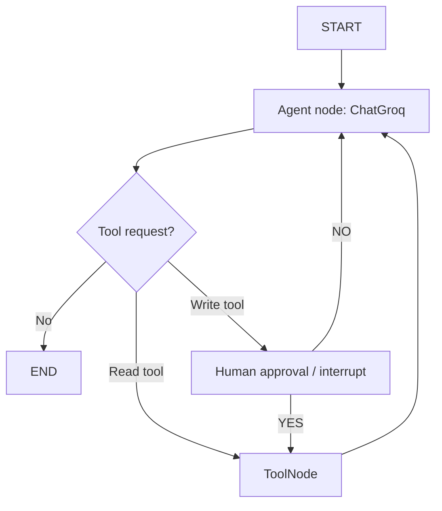

# Demo 6 — Build a LangChain + LangGraph Helpdesk Agent (Groq)

**Audience:** Participants who have finished the five beginner agentic AI labs.  
**Time:** 45–60 minutes.  
**Goal:** Create an agent that can *read helpdesk tickets*, *decide whether tools are needed*, *ask a human before a write*, and *remember prior turns during the running process*.

## 1. Learning outcomes
- Explain the difference between LangChain and LangGraph.
- Define tools using `@tool` and connect them with `ChatGroq.bind_tools()`.
- Build nodes and edges with `StateGraph`.
- Understand conditional routing: agent → tools / approval / end.
- Use an `InMemorySaver` checkpointer to preserve conversation state under a `thread_id`.
- Pause a workflow using `interrupt()` and resume it with `Command(resume=...)`.

## 2. Prerequisites and setup
Install Python 3.10+, VS Code, and have a Groq API key. Open this folder in VS Code.

**Windows (PowerShell):**
```powershell
py -m venv .venv
.venv\Scripts\Activate.ps1
python -m pip install -r requirements.txt
Copy-Item .env.example .env
```
**macOS/Linux:**
```bash
python3 -m venv .venv
source .venv/bin/activate
python -m pip install -r requirements.txt
cp .env.example .env
```
Edit `.env` and set `GROQ_API_KEY` to your API key. Confirm the `GROQ_MODEL` is available to your Groq account and supports tool calling. Do not commit `.env` to Git.

Run:
```bash
python demo_06_langgraph_helpdesk.py
```

## 3. Walk through the code

### Part A — LangChain tools
Open the file and find three `@tool` functions: `list_tickets`, `get_ticket`, and `update_ticket_priority`. The docstrings describe the tools to the language model. All tools work on `data/tickets.json` (no real helpdesk service).

### Part B — ChatGroq and tool binding
Find `ChatGroq(...)` and `model.bind_tools(TOOLS)`. LangChain wraps the Groq model and provides it with structured tool descriptions. The model may request a tool, but it does not directly execute Python code.

### Part C — LangGraph state
Find `AgentState`. `messages` contains the conversation, and `approval_granted` is a routing flag. `add_messages` merges new messages into the state rather than replacing the full list.

### Part D — Nodes and edges
Find `agent_node`, `approval_node`, and `ToolNode(TOOLS)`. Find `decide_next` and `after_approval` to see conditional routing. `START` begins the workflow and `END` finishes it. A tool result returns to the agent so it can interpret the result.

### Part E — Memory
The graph is compiled with `InMemorySaver()`. The CLI uses the *same* `thread_id` across turns, so earlier messages remain accessible while this process runs. This is **not durable memory**: after restarting the script, the conversation history is lost. Changes to the JSON ticket file, however, remain on disk.

### Part F — Human approval
A write request routes to `approval_node`, which calls `interrupt()`. The program displays the proposed tool calls and asks for `YES` or `NO`. `Command(resume=...)` continues the paused graph. Denial returns tool messages saying the action was not executed; approval allows the tool node to execute.

## 4. Classroom tasks

### Exercise 1 — Read
Input: `List all tickets and tell me which have high priority.`
Expected: T102 is high priority in the starter dataset. Observe the `list_tickets` tool call.

### Exercise 2 — Look up
Input: `What is the current priority of T101?`
Expected: `medium`, unless the ticket was changed earlier. Observe `get_ticket`.

### Exercise 3 — Human approval: reject
Input: `Change T101 priority to high.`
When prompted, type `NO`. Verify `data/tickets.json` has not changed.

### Exercise 4 — Human approval: accept
Repeat Exercise 3 but type `YES`. Verify T101's priority becomes `high` in `data/tickets.json`.

### Exercise 5 — Memory in the same conversation
Input: `Which ticket did we just update?`
Expected: The agent should refer to T101 using saved conversation messages.

### Exercise 6 — Conditional routing
Input: `Say hello in one sentence without checking any ticket.`
Observe the agent go directly to `END` if it does not need tools. Compare this with the routes for Exercises 1 and 4.

## 5. How the graph works


## 6. Small coding challenges
1. Add a `get_open_tickets` read-only tool. Bind it in the tools list and rerun Exercise 1.
2. Add a new ticket `T104` in `data/tickets.json` and query it.
3. Set `recursion_limit` to a smaller value and discuss why infinite tool loops are dangerous.
4. Show a graph of the workflow using a LangGraph Mermaid export (optional).

## 7. Troubleshooting
- **Missing GROQ_API_KEY:** Ensure `.env` exists in this directory and contains the key.
- **Model not found / tool use unsupported:** Pick an available tool-capable model in your Groq account and update `GROQ_MODEL`.
- **Import error:** Activate the virtual environment and run `python -m pip install -r requirements.txt`.
- **PowerShell blocks activation:** Use Windows Command Prompt or follow your organization's PowerShell policy; do not disable security controls without approval.
- **No visible tool calls:** The model may answer directly when no tool is needed. Try `Show the current priority of ticket T101 from the data file.`
- **Graph recursion limit:** Try a simpler prompt or inspect whether model/tool calls are repeatedly routed.
- **State lost after restart:** Expected with `InMemorySaver`; it is process memory only.
- **Ticket priority changed from previous run:** Edit `data/tickets.json` to reset T101 priority to `medium`.

## 8. Debrief questions
1. What does LangChain do in this example?
2. What does LangGraph add that the earlier plain Python agent loop did not explicitly express?
3. What is the difference between a tool call and tool execution?
4. Which node decides if human approval is required?
5. Why doesn't `InMemorySaver` remember after restarting the Python process?

## 9. Production safety note
This is an educational demonstration, not a production helpdesk. The local JSON file has no concurrent-write control or account authentication. The in-memory checkpoint is not durable. A real workflow also needs identity/authorization checks, audit logging, durable storage, tighter approval scope, validation and retries for transient errors.
